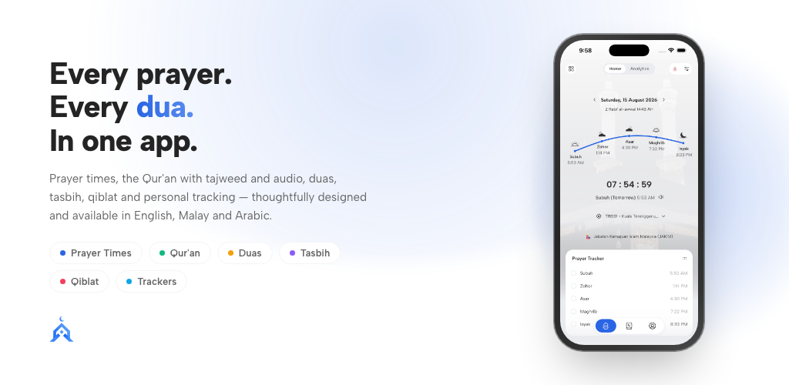

<div align="center">

# Qawwam

### Every prayer. Every dua. In one app.

A complete Islamic companion for daily worship — prayer times, the Qur'an with tajweed and
audio, duas, tasbih, qiblat compass and personal trackers, thoughtfully designed and
available offline in English, Malay and Arabic.

</div>

<br />



<br />

## Everything you need to stay connected

| | | |
| :---: | :---: | :---: |
| 🕋 **Qur'an** — read the mushaf with tajweed colouring, translations, transliteration and audio recitation | 🕌 **Prayer Times** — accurate Waktu Solat from official authorities (JAKIM, Kemenag, MUIS, KHEU) with a time-aware progress arc | 🤲 **Duas** — a categorised library of supplications with Arabic, translation and transliteration |
| 📿 **Tasbih** — digital counter with curated adhkar, vibration feedback and per-dhikr targets | 🧭 **Qiblat** — smooth compass that points to the Kaabah from anywhere | 🗓️ **Islamic Events** — key dates with Hijri and Gregorian dates for the year ahead |
| 💖 **Prayer & Fasting Trackers** — log your daily worship, track streaks and review consistency | 📊 **Analytics** — beautiful charts of your Qur'an reading, prayer and fasting habits | 🌙 **Asma-ul-Husna** — explore the 99 Beautiful Names of Allah |
| 🩸 **Menstrual Tracker** — log haid and istihadah days with cycle predictions and smart reminders | 🌍 **3 Languages** — fully localised in English, Bahasa Malaysia and Arabic | ✨ **More to come** |

<br />

## Available soon

- **iOS & Android** — the app is coming to the App Store and Google Play. Stay tuned.
- Visit the **landing page** at [qawwam.fahadi.my](https://qawwam.fahadi.my/).

## Local development

```bash
npm install
npm run dev          # Vite only — the SPA, without Pages Functions
```

```bash
npm run dev:pages    # build + wrangler pages dev on :8788, with the functions
```

`/khatam/:token` is served by `functions/khatam/[token].ts`, which rewrites the
Open Graph block for link crawlers, and `functions/khatam/[token]/og.ts`, which
renders the 1200×630 share card. Neither runs under plain `vite`.

Both functions read the invite from the API's public
`GET /khatam-invite/:token` (`qawwam-api/docs/khatam-public-invite.md`).
`dev:pages` points `API_BASE` at `http://localhost:8787`. Deployed environments
read it from `wrangler.jsonc`: `env.preview` uses the dev API, production uses
the prod API.

For the browser page under `npm run dev`, create `.env.local`:

```txt
VITE_API_BASE=http://localhost:8787
```

Otherwise it reads the production API. Note `VITE_API_BASE` is baked in at build
time and only affects the browser bundle; the Pages Functions use the `API_BASE`
binding instead.

## Deploying

- `npm run deploy:dev` — preview at `https://dev.qawwam-landing.pages.dev`
  (`--branch=dev`); `qawwam.app` is untouched.
- `npm run deploy` — production, publishes `qawwam.app`.

**Both currently point at the dev API.** `API_BASE` in `wrangler.jsonc` feeds the
Pages Functions; `VITE_API_BASE` in `.env.production` feeds the browser bundle —
that file is loaded by every `vite build`, including the Git-triggered Pages
build. They are separate and must match. This is temporary: when the prod worker
has `/khatam-invite`, change both to `https://qawwam-api-prod.hadiayo39.workers.dev`
and redeploy.

`main` is the production branch, so a push to it also triggers a Pages build that
publishes `qawwam.app`. That is safe while both settings point at dev. Before
switching them to prod, deploy the prod API first — otherwise every invite link
would report itself as invalid.

The card is drawn with satori. Its bundled fork cannot lay out non-Latin text,
and Albert Sans has no Arabic coverage, so a non-Latin journey or owner name is
replaced on the image with a Latin label (`Juz 30`, "You are invited to read
together"). `og:title` and `og:description` still carry the real name.

<br />

<div align="center">

Made with ❤️ for the ummah

© 2026 Qawwam

</div>
