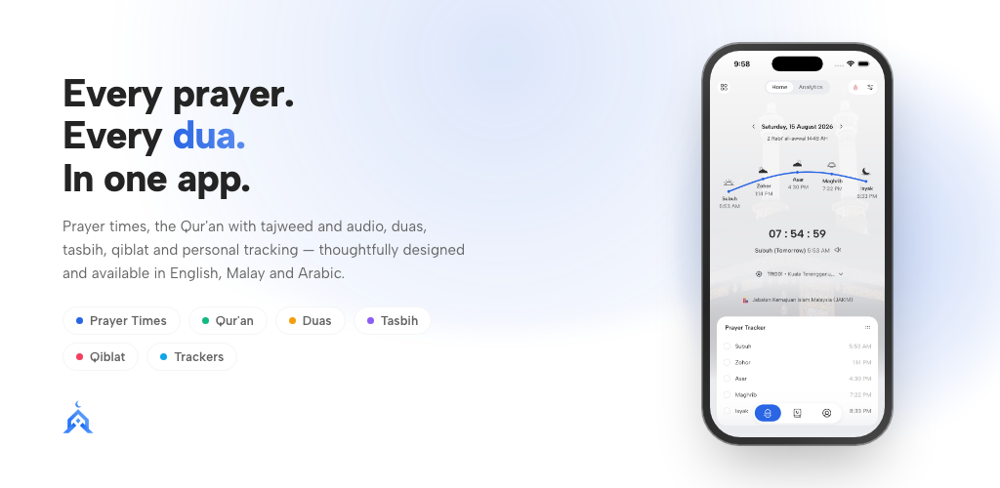

<div align="center">

# Qawwam

### Every prayer. Every dua. In one app.

A complete Islamic companion for daily worship — prayer times, the Qur'an with tajweed and
audio, duas, tasbih, qiblat compass and personal trackers, thoughtfully designed and
available offline in English, Malay and Arabic.

</div>

<br />



<br />

## Everything you need to stay connected

| | | |
| :---: | :---: | :---: |
| 🕋 **Qur'an** — read the mushaf with tajweed colouring, translations, transliteration and audio recitation | 🕌 **Prayer Times** — accurate Waktu Solat from official authorities (JAKIM, Kemenag, MUIS, KHEU) with a time-aware progress arc | 🤲 **Duas** — a categorised library of supplications with Arabic, translation and transliteration |
| 📿 **Tasbih** — digital counter with curated adhkar, vibration feedback and per-dhikr targets | 🧭 **Qiblat** — smooth compass that points to the Kaabah from anywhere | 🗓️ **Islamic Events** — key dates with Hijri and Gregorian dates for the year ahead |
| 💖 **Prayer & Fasting Trackers** — log your daily worship, track streaks and review consistency | 📊 **Analytics** — beautiful charts of your Qur'an reading, prayer and fasting habits | 🌙 **Asma-ul-Husna** — explore the 99 Beautiful Names of Allah |
| 🩸 **Menstrual Tracker** — log haid and istihadah days with cycle predictions and smart reminders | 🌍 **3 Languages** — fully localised in English, Bahasa Malaysia and Arabic | ✨ **More to come** |

<br />

## Available soon

- **iOS & Android** — the app is coming to the App Store and Google Play. Stay tuned.
- Visit the **landing page** at [qawwam.fahadi.my](https://qawwam.fahadi.my/).

## Local development

```bash
npm install
npm run dev          # Vite only — the SPA, without Pages Functions
```

```bash
npm run dev:pages    # build + wrangler pages dev on :8788, with the functions
```

`/khatam/:token` is served by `functions/khatam/[token].ts`, which rewrites the
Open Graph block for link crawlers, and `functions/khatam/[token]/og.ts`, which
renders the 1200×630 share card. Neither runs under plain `vite`.

Both functions read the invite from the API's public
`GET /khatam-invite/:token` (`qawwam-api/docs/khatam-public-invite.md`).
`dev:pages` points `API_BASE` at `http://localhost:8787`. Deployed environments
read it from `wrangler.jsonc`: `env.preview` uses the dev API, production uses
the prod API.

The browser page reads the invite through `/api/khatam-invite/:token`, served by
`functions/api/khatam-invite/[token].ts`. It is same-origin on purpose: the CSP in
`public/_headers` keeps `connect-src 'self'`, so a cross-origin call is refused
before it leaves the browser. The Function passes the upstream status through
unchanged, so a rotated link still reads as invalid rather than as a failure.

`npm run dev` mirrors that with a Vite proxy. Point it at a local API with
`API_BASE=http://localhost:8787 npm run dev`; otherwise it reads the production
API. The proxy target and the Functions' `API_BASE` binding are the only places
the API origin is configured — nothing about it is baked into the bundle.

### Prayer times card

The first feature card reads the protected `/prayer/*` API through
`functions/api/prayer/{zones,times}.ts`. The browser cannot hold the bearer
token, so the Pages Functions add it from `API_TOKEN`.

For `npm run dev:pages`, put the same token the local API uses in `.dev.vars`
(gitignored):

```txt
API_TOKEN=...
```

`npm run dev` (Vite only) proxies `/api/prayer/*` to the dev API with that token.
Set `PRAYER_API_BASE` to point it at another API, e.g.
`PRAYER_API_BASE=http://localhost:8787 npm run dev`. Without a token the card
reports its times as unavailable.

## Deploying

- `npm run deploy:dev` — preview at `https://dev.qawwam-landing.pages.dev`
  (`--branch=dev`); `qawwam.app` is untouched.
- `npm run deploy` — production, publishes `qawwam.app`.

`API_BASE` in `wrangler.jsonc` feeds the Pages Functions, which is now the only
place the API origin is configured: the browser reads the invite same-origin
through `/api/khatam-invite/*`, so no API host is baked into the build.

Set `API_TOKEN` as a Pages secret for preview and production (preview uses the
dev API token, production the prod API token). It is a secret, not a `vars`
entry; the prayer card reports unavailable without it.

The public `/api/prayer/*` proxy is limited to 60 requests per minute per IP by
the `PRAYER_RATE_LIMITER` binding in `wrangler.jsonc`. The limit is approximate
per Cloudflare location. If the Pages project does not accept the Rate Limiting
binding, add an equivalent zone WAF rate-limiting rule on `/api/prayer/*`
instead.

Production reads invites from the prod API, because that is where the store build
mints them; preview deployments keep using the dev API. Both API environments
serve `GET /khatam-invite/:token`.

`main` is the production branch, so a push to it also triggers a Pages build that
publishes `qawwam.app`.

The card is drawn with satori. Its bundled fork cannot lay out non-Latin text,
and Albert Sans has no Arabic coverage, so a non-Latin journey or owner name is
replaced on the image with a Latin label (`Juz 30`, "You are invited to read
together"). `og:title` and `og:description` still carry the real name.

<br />

<div align="center">

Made with ❤️ for the ummah

© 2026 Qawwam

</div>
